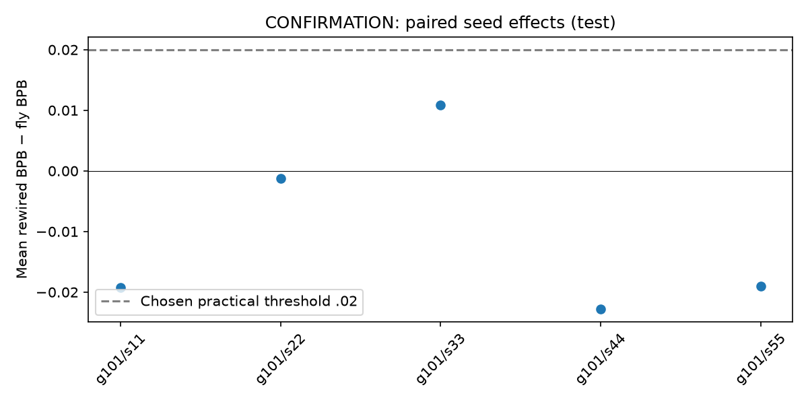

# Final confirmation result — frozen held-out test

No fly-topology advantage is established under this frozen experiment. The mean favors degree-preserving rewiring, but the 95% paired bootstrap interval includes zero, so a clear disadvantage is also not established. This is not proof of equality or a result about biological learning.

All 35 test records are complete: five training seeds, with one fly model and three independently rewired controls per seed, plus random-density, GRU and diagonal-memory baselines. The experiment used a real MaleCNS v1.0 512-neuron/3,061-edge subgraph (sampling seed101) and Tiny Shakespeare, with the predeclared contiguous 90/5/5 split.

Primary scores below use the checkpoint chosen by validation before test access. Final-step checkpoints are reported separately; no checkpoint was selected using test performance. Each checkpoint scored the same 55,769 test prediction positions, with 128-position blocks, state reset and a masked tail. Lower BPB is better.

| Condition | Runs | Active parameters | Mean primary test BPB | Mean final-step test BPB | Mean byte perplexity | Mean accuracy |
|---|---:|---:|---:|---:|---:|---:|
| FLY-TOPOLOGY | 5 | 52981 | 2.638847 | 2.643372 | 6.2285 | 46.9207% |
| DEGREE-REWIRED | 15 | 52981 | 2.628560 | 2.633725 | 6.1843 | 47.1139% |
| RANDOM-DENSITY | 5 | 52981 | 2.582685 | 2.588465 | 5.9906 | 47.6519% |
| PARAMETER-MATCHED-GRU | 5 | 53000 | 2.557536 | 2.570289 | 5.8874 | 49.4145% |
| NO-CROSS-NODE-RECURRENCE | 5 | 50432 | 2.673807 | 2.682296 | 6.3813 | 45.9230% |

Mean byte perplexity is the arithmetic mean of individual run perplexities, not exponentiated mean BPB. GRU has the lowest mean test BPB; these additional architecture comparisons are secondary and have different compute costs.

## Predeclared primary comparison

For each training seed: average the three rewired BPBs, then subtract the single fly BPB. Positive favors fly.

| Seed | Fly test BPB | Mean rewired test BPB | Rewired minus fly |
|---|---:|---:|---:|
| 11 | 2.636703 | 2.617433 | -0.019270 |
| 22 | 2.627109 | 2.625839 | -0.001270 |
| 33 | 2.632542 | 2.643449 | +0.010907 |
| 44 | 2.652527 | 2.629739 | -0.022788 |
| 55 | 2.645352 | 2.626340 | -0.019012 |

**Mean delta: -0.010287 BPB. 95% paired bootstrap interval: [-0.020626, +0.001733].** 10,000 seed-level resamples, seed1729. Four seed-level means favor rewiring; one favors fly. The interval includes zero and does not support the predeclared +0.02 BPB practical fly advantage. Only five training seeds inform this interval; it does not estimate variation across animals or graph samples.

Secondary final-step contrast: -0.009647 BPB, interval [-0.018598, +0.000245]. This does not replace the primary selection rule.

Train-only additive-smoothed references (not parameter matched): unigram test BPB 4.850567; bigram 3.608388.

## Integrity and execution

The final audit checked the exact complete frozen matrix, all 70 checkpoint identities against hashes recorded before test access, validation-selected steps, score arithmetic, test-record/summary agreement, and an independent recalculation of the paired bootstrap. Test inference was performed by the user's explicit final-evaluate command; this review used its immutable artifacts and did not repeat test inference. The preceding audit replayed validation and verified degrees, initial interfaces/edge slots, training-window RNGs, learned recurrent weights and full budgets.

Every model trained 20,000 updates, batch8/context128, lr .003, CPU float32 with two threads: 20,480,000 prediction-byte exposures per run, 716,800,000 total. No failed or missing runs were dropped. Training wall time was 4.462 hours. Equal parameter counts and bytes do not mean equal compute; GRU averaged 141.305 training seconds versus 508.623 for fly.

## Predeclared validation-only dependence checks

The fixed checks below were applied to copies of every validation-selected model after the main experiment. No checkpoint, graph, hyperparameter or test score was changed. Higher BPB after intervention measures dependence on the trained recurrence; damaging parameters is not evidence of a special anatomical benefit.

| Condition | Baseline validation BPB | Zero core | Reset every byte | Zero fixed 10% of coefficients |
|---|---:|---:|---:|---:|
| FLY-TOPOLOGY | 2.496182 | 4.396036 | 3.821059 | 2.893222 |
| DEGREE-REWIRED | 2.481610 | 4.380861 | 3.814740 | 2.834000 |
| RANDOM-DENSITY | 2.446179 | 4.332601 | 3.803787 | 2.763836 |
| PARAMETER-MATCHED-GRU | 2.359059 | 4.471450 | 3.754707 | n/a |
| NO-CROSS-NODE-RECURRENCE | 2.531805 | 4.875774 | 3.820016 | 2.991358 |

For the GRU, zero-core removes hidden-to-hidden matrices; for graph and diagonal models, it zeros recurrent coefficients. These are architecture-specific dependence checks. The diagonal model's 10% intervention affects independent memory coefficients. Fixed-prompt samples were generated for all 35 models: first 32 training bytes, 128 generated bytes, temperature .8, same generation seed within each training-seed group. All samples are retained in [validation-diagnostics-review.json](validation-diagnostics-review.json); none are selected as topology evidence.

## Limits and provenance

One locally sampled subgraph from one specimen, mostly visual neurons; roughly 92% of the selected neurons' filtered connectivity falls outside the subset and is omitted. Dense artificial interfaces, unrestricted learned signs, a single small text corpus, a fixed training budget, and only five training seeds limit generalization. Exact degree preservation does not establish uniform mixing of rewired controls. A lack of a clear difference is not proof that the architectures are equivalent.

Code SHA-256: `be167f981fada51829a4d6519e42adf2481c08e85c5d753781c58918bdbd41e8`. Freeze file SHA-256: `ffb133aefbbdcfba44463ba1303d2834c7d449332aaca4358516bca15d6b52e5`. Analysis plan SHA-256: `181384189b8fcd4b9c51ba9596549e9d9e94e2650eadd2ed09eb28f542265c15`. Git revision unavailable. No frozen code, plan, data, configuration or checkpoint was modified. The test split has now been used; future revisions must not treat it as unseen or retune this frozen study using these scores.

The original unit suite remains 31 passed / 2 unavailable-accelerator skips; unchanged experiment code was not retested. New validation and test-artifact audits passed. No additional training, replication, paid compute or uploads were launched. The initial one-subgraph confirmation is complete; broader replication remains unrun.

[Full per-run report and curves](report.md) · [final audit](final-audit.json) · [audit source](audit_final.py) · [machine-readable final summary](final-review-summary.json) · [primary and secondary paired analysis](final-test-effects.json) · [earlier validation review](validation-review.md)
