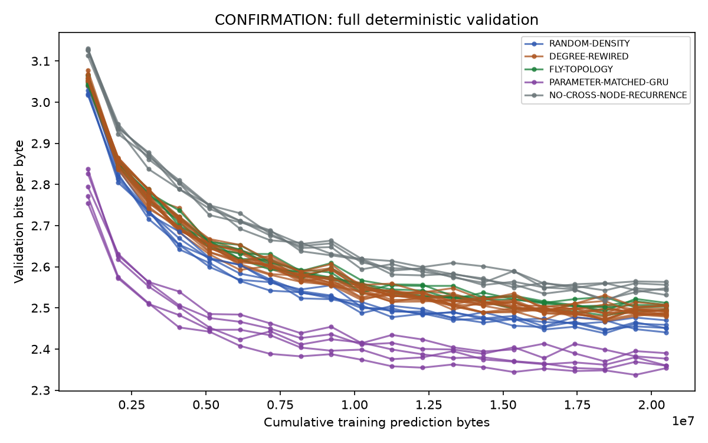
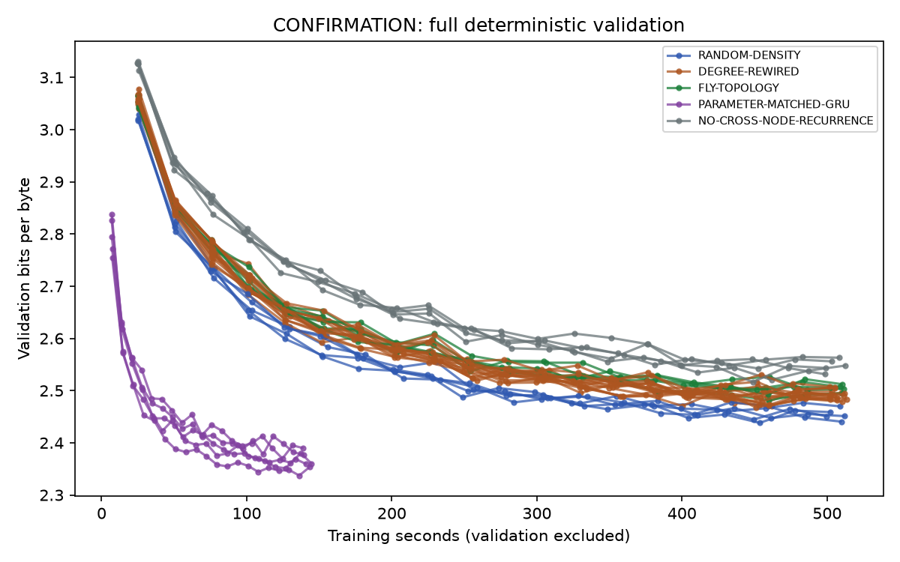
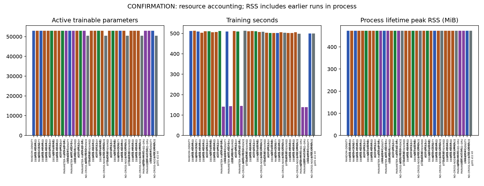
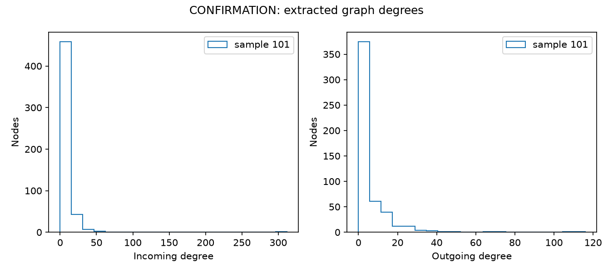

# CONFIRMATION — small connectome-constrained language model

Final test results available for the frozen matrix; inspect paired effects and limitations below.

Report generated 2026-10-05T23:44:44.268739+00:00. Completed 35/35 runs. Failed/incomplete 0, missing 0.

Code SHA-256: `be167f981fada51829a4d6519e42adf2481c08e85c5d753781c58918bdbd41e8`. Git revision: `None` (null means unavailable).
Corpus manifest SHA-256: `c2bd9accdfb33e97032a4927e75dfa3e8b7822eec10e09b7fe68e693b1409f90`.
Analysis plan SHA-256: `181384189b8fcd4b9c51ba9596549e9d9e94e2650eadd2ed09eb28f542265c15`. Freeze: `13aa5c95b78a1a99a421ae0bce6eeb7278b73d6b489772b488b514b82bf7b083`.

Command argv: `['/Users/Rodela1/Code/Flybrain/fly_connectome_lm/src/fly_connectome_lm/cli.py', 'run', '--config', 'confirmation', '--freeze', 'fly_connectome_lm/configs/confirmation-frozen.json']`.

| Condition | Sample / seed / null | Best validation BPB | Final validation BPB | Byte exposures | Selected step | Train seconds |
|---|---|---:|---:|---:|---:|---:|
| RANDOM-DENSITY | 101/33/0 | 2.447270 | 2.451091 | 20480000 | 18000 | 512.076 |
| DEGREE-REWIRED | 101/11/2 | 2.470246 | 2.483271 | 20480000 | 18000 | 513.296 |
| RANDOM-DENSITY | 101/44/0 | 2.440557 | 2.440557 | 20480000 | 20000 | 509.776 |
| DEGREE-REWIRED | 101/22/3 | 2.471646 | 2.498563 | 20480000 | 18000 | 503.197 |
| DEGREE-REWIRED | 101/33/1 | 2.486990 | 2.496276 | 20480000 | 19000 | 510.010 |
| FLY-TOPOLOGY | 101/33/0 | 2.481693 | 2.494666 | 20480000 | 18000 | 510.505 |
| DEGREE-REWIRED | 101/33/2 | 2.485834 | 2.491854 | 20480000 | 18000 | 504.960 |
| DEGREE-REWIRED | 101/44/1 | 2.481564 | 2.481564 | 20480000 | 20000 | 507.057 |
| FLY-TOPOLOGY | 101/44/0 | 2.501372 | 2.503594 | 20480000 | 19000 | 511.458 |
| PARAMETER-MATCHED-GRU | 101/22/0 | 2.351352 | 2.359520 | 20480000 | 18000 | 140.799 |
| RANDOM-DENSITY | 101/55/0 | 2.460354 | 2.469852 | 20480000 | 17000 | 509.045 |
| PARAMETER-MATCHED-GRU | 101/55/0 | 2.337246 | 2.353412 | 20480000 | 19000 | 143.281 |
| DEGREE-REWIRED | 101/55/2 | 2.488825 | 2.494340 | 20480000 | 17000 | 511.952 |
| FLY-TOPOLOGY | 101/11/0 | 2.503778 | 2.507046 | 20480000 | 17000 | 508.966 |
| PARAMETER-MATCHED-GRU | 101/33/0 | 2.360113 | 2.360113 | 20480000 | 20000 | 144.666 |
| NO-CROSS-NODE-RECURRENCE | 101/33/0 | 2.520601 | 2.547901 | 20480000 | 18000 | 512.340 |
| DEGREE-REWIRED | 101/11/3 | 2.470945 | 2.478846 | 20480000 | 18000 | 510.365 |
| DEGREE-REWIRED | 101/11/1 | 2.473052 | 2.490695 | 20480000 | 18000 | 511.248 |
| FLY-TOPOLOGY | 101/22/0 | 2.492557 | 2.512288 | 20480000 | 18000 | 510.265 |
| DEGREE-REWIRED | 101/55/1 | 2.483473 | 2.485745 | 20480000 | 17000 | 506.932 |
| NO-CROSS-NODE-RECURRENCE | 101/55/0 | 2.548160 | 2.563066 | 20480000 | 17000 | 508.266 |
| DEGREE-REWIRED | 101/55/3 | 2.492804 | 2.492804 | 20480000 | 20000 | 502.738 |
| FLY-TOPOLOGY | 101/55/0 | 2.501512 | 2.505973 | 20480000 | 18000 | 501.922 |
| DEGREE-REWIRED | 101/22/1 | 2.486915 | 2.507258 | 20480000 | 18000 | 501.589 |
| RANDOM-DENSITY | 101/22/0 | 2.438114 | 2.458805 | 20480000 | 18000 | 502.399 |
| DEGREE-REWIRED | 101/22/2 | 2.479268 | 2.506055 | 20480000 | 18000 | 505.430 |
| NO-CROSS-NODE-RECURRENCE | 101/22/0 | 2.542465 | 2.556015 | 20480000 | 18000 | 503.204 |
| DEGREE-REWIRED | 101/44/2 | 2.482895 | 2.482895 | 20480000 | 20000 | 502.243 |
| DEGREE-REWIRED | 101/33/3 | 2.467634 | 2.487994 | 20480000 | 18000 | 501.696 |
| DEGREE-REWIRED | 101/44/3 | 2.502059 | 2.504693 | 20480000 | 16000 | 505.075 |
| NO-CROSS-NODE-RECURRENCE | 101/44/0 | 2.531434 | 2.531434 | 20480000 | 20000 | 498.442 |
| PARAMETER-MATCHED-GRU | 101/11/0 | 2.369909 | 2.390018 | 20480000 | 18000 | 138.633 |
| PARAMETER-MATCHED-GRU | 101/44/0 | 2.376676 | 2.376676 | 20480000 | 20000 | 139.145 |
| RANDOM-DENSITY | 101/11/0 | 2.444602 | 2.450757 | 20480000 | 18000 | 499.642 |
| NO-CROSS-NODE-RECURRENCE | 101/11/0 | 2.516365 | 2.543356 | 20480000 | 18000 | 498.978 |

Reproduce from project directory: `./fly-lm run --config confirmation --freeze fly_connectome_lm/configs/confirmation-frozen.json`.

Train-only additive-smoothed sanity references (not parameter matched):
- Unigram validation BPB: 4.808269.
- Bigram validation BPB: 3.585333.

| Condition | Sample / seed / null | Best test BPB | Final test BPB | Byte perplexity | Accuracy |
|---|---|---:|---:|---:|---:|
| RANDOM-DENSITY | 101/33/0 | 2.582102 | 2.580404 | 5.9881 | 0.476627 |
| DEGREE-REWIRED | 101/11/2 | 2.608187 | 2.612165 | 6.0974 | 0.475874 |
| RANDOM-DENSITY | 101/44/0 | 2.581373 | 2.581373 | 5.9851 | 0.481468 |
| DEGREE-REWIRED | 101/22/3 | 2.631784 | 2.649710 | 6.1979 | 0.472736 |
| DEGREE-REWIRED | 101/33/1 | 2.629376 | 2.628815 | 6.1876 | 0.471714 |
| FLY-TOPOLOGY | 101/33/0 | 2.632542 | 2.637528 | 6.2012 | 0.470351 |
| DEGREE-REWIRED | 101/33/2 | 2.652755 | 2.645984 | 6.2887 | 0.469544 |
| DEGREE-REWIRED | 101/44/1 | 2.631903 | 2.631903 | 6.1984 | 0.473148 |
| FLY-TOPOLOGY | 101/44/0 | 2.652527 | 2.642941 | 6.2877 | 0.468952 |
| PARAMETER-MATCHED-GRU | 101/22/0 | 2.569581 | 2.610022 | 5.9364 | 0.494827 |
| RANDOM-DENSITY | 101/55/0 | 2.588948 | 2.588154 | 6.0166 | 0.471176 |
| PARAMETER-MATCHED-GRU | 101/55/0 | 2.575361 | 2.583487 | 5.9602 | 0.493590 |
| DEGREE-REWIRED | 101/55/2 | 2.632951 | 2.633122 | 6.2029 | 0.470136 |
| FLY-TOPOLOGY | 101/11/0 | 2.636703 | 2.631671 | 6.2191 | 0.469723 |
| PARAMETER-MATCHED-GRU | 101/33/0 | 2.551501 | 2.551501 | 5.8624 | 0.493572 |
| NO-CROSS-NODE-RECURRENCE | 101/33/0 | 2.693568 | 2.691551 | 6.4691 | 0.457189 |
| DEGREE-REWIRED | 101/11/3 | 2.623882 | 2.612790 | 6.1641 | 0.473220 |
| DEGREE-REWIRED | 101/11/1 | 2.620229 | 2.625114 | 6.1485 | 0.473883 |
| FLY-TOPOLOGY | 101/22/0 | 2.627109 | 2.649471 | 6.1779 | 0.468665 |
| DEGREE-REWIRED | 101/55/1 | 2.615837 | 2.628308 | 6.1298 | 0.471050 |
| NO-CROSS-NODE-RECURRENCE | 101/55/0 | 2.662263 | 2.685222 | 6.3303 | 0.459736 |
| DEGREE-REWIRED | 101/55/3 | 2.630233 | 2.630233 | 6.1913 | 0.472252 |
| FLY-TOPOLOGY | 101/55/0 | 2.645352 | 2.655250 | 6.2565 | 0.468343 |
| DEGREE-REWIRED | 101/22/1 | 2.637873 | 2.657674 | 6.2241 | 0.466227 |
| RANDOM-DENSITY | 101/22/0 | 2.578448 | 2.604396 | 5.9730 | 0.476734 |
| DEGREE-REWIRED | 101/22/2 | 2.607860 | 2.629267 | 6.0960 | 0.469436 |
| NO-CROSS-NODE-RECURRENCE | 101/22/0 | 2.680862 | 2.684585 | 6.4124 | 0.457010 |
| DEGREE-REWIRED | 101/44/2 | 2.619986 | 2.619986 | 6.1474 | 0.473130 |
| DEGREE-REWIRED | 101/33/3 | 2.648216 | 2.657914 | 6.2689 | 0.468145 |
| DEGREE-REWIRED | 101/44/3 | 2.637326 | 2.642892 | 6.2218 | 0.466585 |
| NO-CROSS-NODE-RECURRENCE | 101/44/0 | 2.665041 | 2.665041 | 6.3425 | 0.460632 |
| PARAMETER-MATCHED-GRU | 101/11/0 | 2.528727 | 2.543924 | 5.7706 | 0.495185 |
| PARAMETER-MATCHED-GRU | 101/44/0 | 2.562510 | 2.562510 | 5.9073 | 0.493554 |
| RANDOM-DENSITY | 101/11/0 | 2.582553 | 2.587995 | 5.9900 | 0.476591 |
| NO-CROSS-NODE-RECURRENCE | 101/11/0 | 2.667302 | 2.685082 | 6.3524 | 0.461583 |

{'101': {'mean_delta': -0.010286725443305578, 'ci95': [-0.020625748345769957, 0.0017325204060923305], 'training_seed_count': 5, 'interpretation': 'Fly wiring may be worse under this protocol; inspect uncertainty.'}}

Five seeds offer limited uncertainty; never bootstrap individual test bytes.
Samples can overlap and come from one specimen; not independent flies.

Every run-level metric, seed, graph/config hash, accounting field and timing is preserved in [evidence.json](evidence.json).

Limitations: local BFS sampling biases circuit selection; degree-preserving swaps do not prove uniform null sampling; no strong-connectivity matching; one specimen; narrow Shakespeare benchmark and repeated material; engineered dense interfaces and artificial learned signs; equal parameter count does not equal compute; CPU RSS is process lifetime high-water. Smoke cannot answer the scientific hypothesis. No biological language or whole-brain claims.
