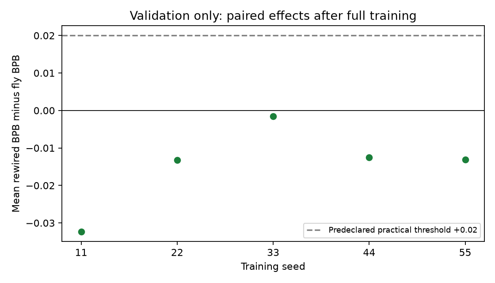

# Completed confirmation training — validation review

All 35 runs completed and passed the post-run integrity audit. The test set has not been evaluated. These validation scores selected the checkpoints, so they are not the predeclared primary test outcome.

Execution: 2026-10-05T18:55:03.069761+00:00 to 2026-10-05T23:22:44.835351+00:00; 4.462 hours wall time. Real male-cns:v1.0, sample101, N512/E3061; five training seeds11/22/33/44/55, three independently rewired controls each.

Every run trained 20,000 updates at batch8/context128 and selected lr .003: 20,480,000 prediction-byte exposures per run, 716,800,000 total. Unique training corpus: 1,003,854 bytes. CPU float32/dense execution, two threads.

| Condition | Runs | Active parameters | Mean best-validation BPB | Mean final-validation BPB | Mean training seconds |
|---|---:|---:|---:|---:|---:|
| FLY-TOPOLOGY | 5 | 52981 | 2.496182 | 2.504713 | 508.623 |
| DEGREE-REWIRED | 15 | 52981 | 2.481610 | 2.492190 | 506.519 |
| RANDOM-DENSITY | 5 | 52981 | 2.446179 | 2.454212 | 506.588 |
| PARAMETER-MATCHED-GRU | 5 | 53000 | 2.359059 | 2.367948 | 141.305 |
| NO-CROSS-NODE-RECURRENCE | 5 | 50432 | 2.531805 | 2.548355 | 504.246 |

Lower BPB is better. Rewired controls have lower mean validation BPB than fly topology; GRU is lowest. This validation comparison provides no fly-wiring advantage. It does not establish the final held-out result.

| Training seed | Fly validation BPB | Mean of three rewired validation BPBs | Rewired minus fly |
|---|---:|---:|---:|
| 11 | 2.503778 | 2.471414 | -0.032364 |
| 22 | 2.492557 | 2.479276 | -0.013281 |
| 33 | 2.481693 | 2.480153 | -0.001540 |
| 44 | 2.501372 | 2.488839 | -0.012533 |
| 55 | 2.501512 | 2.488367 | -0.013145 |

Descriptive paired validation mean: -0.014572 BPB; 95% percentile interval [-0.024581, -0.006182]. 10,000 resamples of the five seed-level differences, after averaging each seed's three controls. Five seeds provide limited uncertainty; reused fly runs are not treated as independent observations. The interval is descriptive validation analysis, not a primary test result.



Audit passed: frozen code/plan/corpus/graph/run identities; full budgets and validation schedules; all 70 best/final checkpoint identities; replayed validation metrics (all differences below 1e-6); exact labelled degrees and swap policy; matched initial recurrent slots and interfaces; optimizer settings; final training-window RNG states; finite losses and changed recurrent weights.

Selected steps: {16000: 1, 17000: 5, 18000: 19, 19000: 3, 20000: 7}. Every run still consumed its full budget. 28/35 selected an earlier checkpoint than step20,000; final checkpoint scores are reported separately. No training recipe, code, analysis plan, graph sample or checkpoint-selection rule was changed.

Training time 15901.594s; validation 98.067s. Equal parameter counts and training bytes do not imply equal compute. The GRU was faster in this CPU implementation.

Limitations: one locally sampled subgraph from one specimen; mostly visual neurons; approximately 92% of external filtered connectivity cut; dense artificial interfaces and unrestricted learned signs; one small text corpus; degree preservation does not prove uniform null mixing. No biological learning or general-language superiority claim.

Code SHA-256: `be167f981fada51829a4d6519e42adf2481c08e85c5d753781c58918bdbd41e8`. Freeze file SHA-256: `ffb133aefbbdcfba44463ba1303d2834c7d449332aaca4358516bca15d6b52e5`. Analysis plan SHA-256: `181384189b8fcd4b9c51ba9596549e9d9e94e2650eadd2ed09eb28f542265c15`. No Git revision available.

No retraining, test evaluation, paid compute, replication or optional intervention/text-generation diagnostics were launched in this review. The unchanged source retains its prior unit-test result (31 passed, 2 accelerator skips); this follow-up added and passed the artifact/validation audit.

Full run values and plots: [generated report](report.md). Audit: [audit.json](audit.json), [audit source](audit_confirmation.py). Machine-readable review: [review-summary.json](review-summary.json).

Next command, from `/Users/Rodela1/Code/Flybrain`, explicitly scores the frozen best and final checkpoints on the held-out test set; it does not retrain or select new checkpoints:

```sh
./fly_connectome_lm/fly-lm final-evaluate --freeze fly_connectome_lm/configs/confirmation-frozen.json
```
