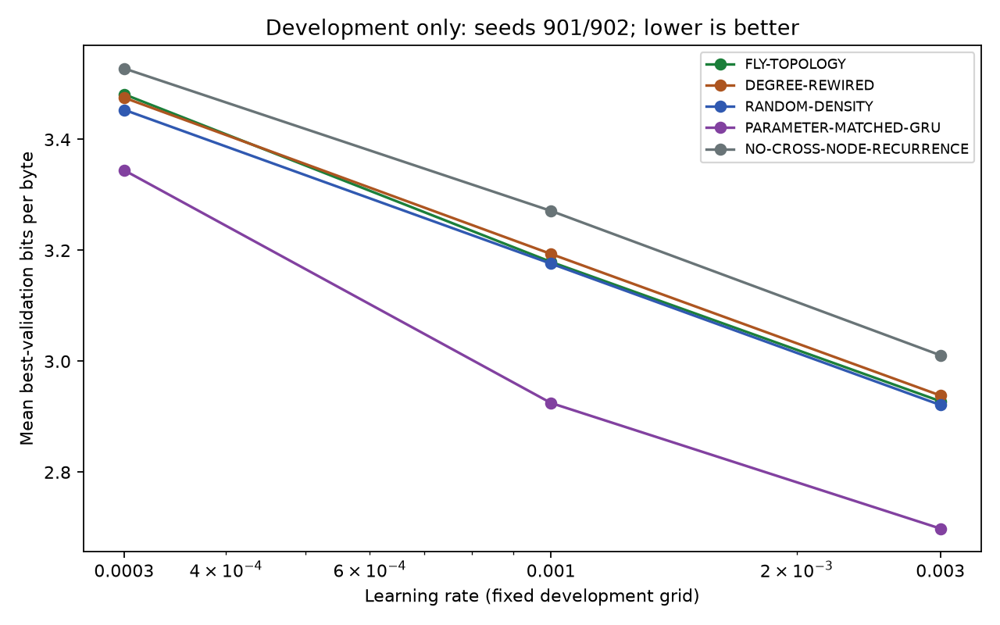

# Development grid — audited validation-only results

All 30 predeclared development trials completed: 3 learning rates × 2 development seeds (901/902) × 5 required conditions. Each consumed 2,000 updates and 1,024,000 prediction-byte exposures. No failed or missing trial was excluded. Total exposures: 30,720,000. No test evaluation was performed.

**Selected rate: 0.003 for the shared graph family and independently for the GRU.** The graph rate is selected from pooled FLY-TOPOLOGY and DEGREE-REWIRED validation over both seeds, then applied unchanged to A/B/C/E. Widths, anatomy, null policy and other settings are unchanged. It is the best rate in this fixed grid, not a claim of global optimality.

| Learning rate | Pooled fly + rewired best-validation BPB | GRU mean best-validation BPB |
|---|---:|---:|
| 0.0003 | 3.478438 | 3.344572 |
| 0.001 | 3.186370 | 2.924730 |
| 0.003 | 2.933066 | 2.698202 |

No rates beyond the predeclared grid were tried. C/E do not receive separately optimized rates. Development seeds are excluded from confirmation estimates. These selected validation scores are not independent confirmation evidence.

## Every condition and rate

| Rate | Condition | Mean best-validation BPB | Mean final-validation BPB |
|---|---|---:|---:|
| 0.0003 | FLY-TOPOLOGY | 3.481521 | 3.481521 |
| 0.0003 | DEGREE-REWIRED | 3.475355 | 3.475355 |
| 0.0003 | RANDOM-DENSITY | 3.453530 | 3.453530 |
| 0.0003 | PARAMETER-MATCHED-GRU | 3.344572 | 3.344572 |
| 0.0003 | NO-CROSS-NODE-RECURRENCE | 3.528099 | 3.528099 |
| 0.001 | FLY-TOPOLOGY | 3.179191 | 3.179191 |
| 0.001 | DEGREE-REWIRED | 3.193549 | 3.193549 |
| 0.001 | RANDOM-DENSITY | 3.176053 | 3.176053 |
| 0.001 | PARAMETER-MATCHED-GRU | 2.924730 | 2.924730 |
| 0.001 | NO-CROSS-NODE-RECURRENCE | 3.271208 | 3.271208 |
| 0.003 | FLY-TOPOLOGY | 2.927910 | 2.933476 |
| 0.003 | DEGREE-REWIRED | 2.938221 | 2.946501 |
| 0.003 | RANDOM-DENSITY | 2.921082 | 2.921665 |
| 0.003 | PARAMETER-MATCHED-GRU | 2.698202 | 2.698202 |
| 0.003 | NO-CROSS-NODE-RECURRENCE | 3.010760 | 3.011242 |



## Audit

- Matched every selection trial back to its run manifest, full history and checkpoint. Verified all 60 best/final checkpoint identities, exact budgets, validation schedules and checkpoint-selection minima.
- Recomputed the pooled selection scores and winners from run-level values. Replayed all best-checkpoint validation scores; separately replayed final checkpoints where different. All matched within 1e-6 BPB.
- Verified code/data/plan/graph hashes, exact labelled degrees and valid null-swap budgets, matching initial fly/null edge-slot weights, training-window RNG states, active parameter counts and finite losses/gradients. All graph cores changed. Graph realizations stayed the same across rates for each seed/condition.
- No test loader was invoked, and no test-result file exists. No training was launched during this review. Experiment source, presets, analysis plan and existing run artifacts were preserved.

Aggregate logged training: 1054.927s; validation: 80.543s. The predeclared optional fixed-time budget, derived from pooled development profiling, is 35.164231s. The next stage remains the primary fixed-byte protocol; no fixed-time study ran.

[Audit](audit.json), [audit script](audit_development.py), [all run values](run-values.json), [machine-readable summary](review-summary.json).

Per-rate reports: [0.0003](../development-63e04511192f/report.md), [0.001](../development-62e5665af1bf/report.md), [0.003](../development-61a97ac45aec/report.md).

## Frozen confirmation — not launched

Created [confirmation-frozen.json](../../configs/confirmation-frozen.json) from the audited selection. Its hashes bind code, corpus, analysis plan, graph, selected rates, checkpoint-selection rule and exact run IDs. The preset base lr remains .001 for compatibility; frozen learning_rates override it to .003 in every resolved run, checked in the dry run.

The exact matrix contains 35 untrained runs: confirmation seeds 11/22/33/44/55; one fly, three independently rewired nulls, one random-density, one GRU and one diagonal arm per seed. Each receives 20,000 updates, batch8/context128, totaling 20,480,000 prediction bytes per run and 716,800,000 over the matrix. Each fly is trained once. Test remains sealed throughout confirmation training.

Freeze SHA-256: `ffb133aefbbdcfba44463ba1303d2834c7d449332aaca4358516bca15d6b52e5`. Code SHA-256: `be167f981fada51829a4d6519e42adf2481c08e85c5d753781c58918bdbd41e8`. Git revision: null (no Git repository). Plan SHA-256: `181384189b8fcd4b9c51ba9596549e9d9e94e2650eadd2ed09eb28f542265c15`. Selection file SHA-256: `b8e1080653f588e9beabf3eb65ba524072dd8beacadc7fb84828cd81d99efa4c`.

[Resolved confirmation matrix](../confirmation-frozen-run-matrix.json). Estimates exclude allocator/library overhead and are not runtime promises. The next command was dry-run checked but has not been executed:

```sh
./fly_connectome_lm/fly-lm run --config confirmation --freeze fly_connectome_lm/configs/confirmation-frozen.json
```

This starts the full local confirmation training matrix. Final test evaluation is a separate explicit command after completion. One specimen, a local graph sample and a narrow corpus still limit interpretation; development scores must not be reported as confirmation results.
