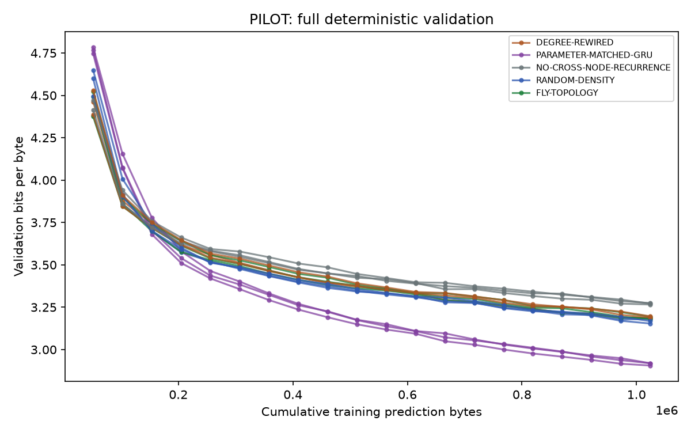
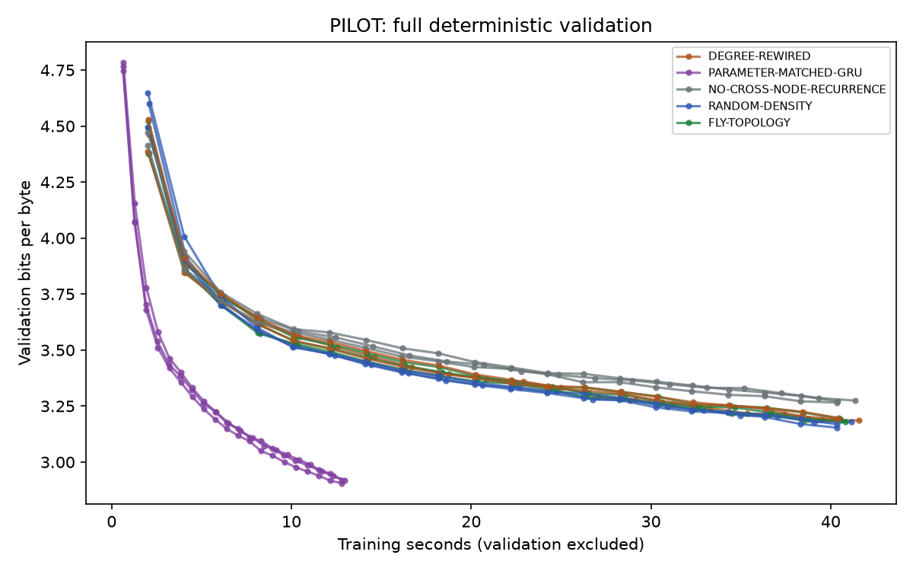
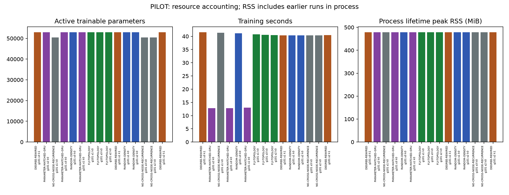
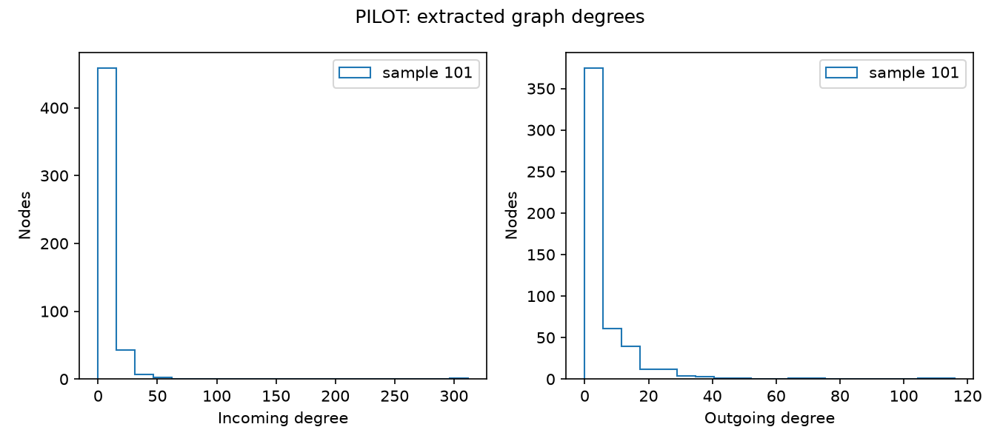
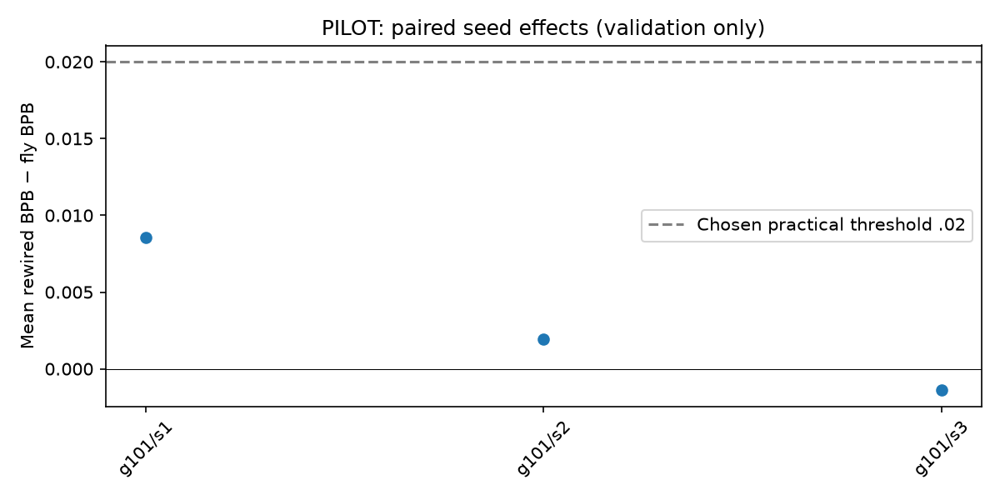

# PILOT — small connectome-constrained language model

Validation-only comparison. The sealed test set has not been evaluated. No confirmatory topology conclusion is available.

Report generated 2026-10-05T18:20:13.692240+00:00. Completed 15/15 runs. Failed/incomplete 0, missing 0.

Code SHA-256: `be167f981fada51829a4d6519e42adf2481c08e85c5d753781c58918bdbd41e8`. Git revision: `None` (null means unavailable).
Corpus manifest SHA-256: `c2bd9accdfb33e97032a4927e75dfa3e8b7822eec10e09b7fe68e693b1409f90`.
Analysis plan SHA-256: `181384189b8fcd4b9c51ba9596549e9d9e94e2650eadd2ed09eb28f542265c15`. Freeze: `None`.

Command argv: `['/Users/Rodela1/Code/Flybrain/fly_connectome_lm/src/fly_connectome_lm/cli.py', 'run', '--config', 'pilot']`.

| Condition | Sample / seed / null | Best validation BPB | Final validation BPB | Byte exposures | Selected step | Train seconds |
|---|---|---:|---:|---:|---:|---:|
| DEGREE-REWIRED | 101/3/1 | 3.185975 | 3.185975 | 1024000 | 2000 | 41.576 |
| PARAMETER-MATCHED-GRU | 101/2/0 | 2.919509 | 2.919509 | 1024000 | 2000 | 12.810 |
| NO-CROSS-NODE-RECURRENCE | 101/1/0 | 3.274375 | 3.274375 | 1024000 | 2000 | 41.371 |
| PARAMETER-MATCHED-GRU | 101/3/0 | 2.905856 | 2.905856 | 1024000 | 2000 | 12.811 |
| RANDOM-DENSITY | 101/3/0 | 3.177891 | 3.180324 | 1024000 | 1900 | 41.134 |
| PARAMETER-MATCHED-GRU | 101/1/0 | 2.919414 | 2.919414 | 1024000 | 2000 | 12.981 |
| FLY-TOPOLOGY | 101/1/0 | 3.181319 | 3.181319 | 1024000 | 2000 | 40.787 |
| FLY-TOPOLOGY | 101/3/0 | 3.187355 | 3.187355 | 1024000 | 2000 | 40.564 |
| FLY-TOPOLOGY | 101/2/0 | 3.194526 | 3.194526 | 1024000 | 2000 | 40.496 |
| DEGREE-REWIRED | 101/1/1 | 3.189857 | 3.189857 | 1024000 | 2000 | 40.388 |
| RANDOM-DENSITY | 101/1/0 | 3.153821 | 3.153821 | 1024000 | 2000 | 40.344 |
| RANDOM-DENSITY | 101/2/0 | 3.168250 | 3.168250 | 1024000 | 2000 | 40.359 |
| NO-CROSS-NODE-RECURRENCE | 101/3/0 | 3.265766 | 3.265766 | 1024000 | 2000 | 40.345 |
| NO-CROSS-NODE-RECURRENCE | 101/2/0 | 3.271407 | 3.271407 | 1024000 | 2000 | 40.370 |
| DEGREE-REWIRED | 101/2/1 | 3.196486 | 3.196486 | 1024000 | 2000 | 40.438 |

Reproduce from project directory: `./fly-lm run --config pilot`.

Train-only additive-smoothed sanity references (not parameter matched):
- Unigram validation BPB: 4.808269.
- Bigram validation BPB: 3.585333.

{'101': {'mean_delta': 0.003039452531965914, 'ci95': [-0.0013800394634051472, 0.008537979913643579], 'training_seed_count': 3, 'interpretation': 'Insufficient confirmation seeds; descriptive only.'}}

Five seeds offer limited uncertainty; never bootstrap individual test bytes.
Samples can overlap and come from one specimen; not independent flies.

Every run-level metric, seed, graph/config hash, accounting field and timing is preserved in [evidence.json](evidence.json).

Limitations: local BFS sampling biases circuit selection; degree-preserving swaps do not prove uniform null sampling; no strong-connectivity matching; one specimen; narrow Shakespeare benchmark and repeated material; engineered dense interfaces and artificial learned signs; equal parameter count does not equal compute; CPU RSS is process lifetime high-water. Smoke cannot answer the scientific hypothesis. No biological language or whole-brain claims.
