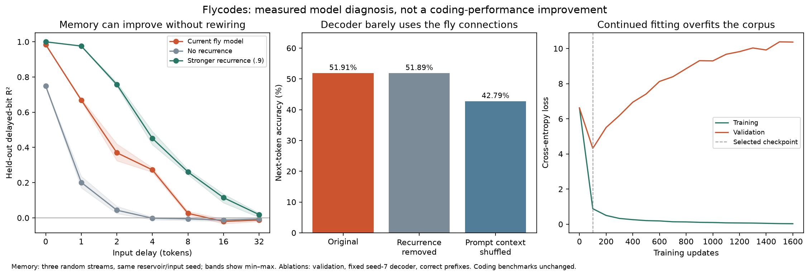

# Flycodes model backtrace

Diagnostic directory: `backtrace-20261009T180612`; source coding run: `curriculum-20261009T163310`.

The current failure is a property of our frozen-reservoir coding system. It does not establish a limit on biological flies or on every connectome-constrained architecture. No coding checkpoint or recorded connection was changed. The only fitted additions are separate diagnostic readers, which never generate benchmark solutions.



## 1. The recurrent wiring has very weak influence on the coding decoder

| Saved fly head | Original validation accuracy | Same head, recurrence removed | Next-token choices changed | Shuffled prompt context accuracy |
|---|---:|---:|---:|---:|
| fly-s7 | 51.909% | 51.887% | 0.131% | 42.789% |
| fly-s19 | 50.796% | 50.796% | 0.109% | 42.287% |

Across cached validation states, removing recurrence changes the pooled current-state feature matrix by 0.084% in relative Frobenius norm. This is a specific norm comparison, not a percentage of biological brain activity. With separately trained matched controls, 117/124 previously recorded generated programs are byte-identical.

Inference: the current input/decoder system can perform almost all of its observed code prediction without the fly connections. Prompt-context shuffling does hurt, so the decoder is using information about the question. The weak contribution is specifically recurrent graph processing. Ablations hold the coding head fixed; they measure sensitivity, not the best possible retrained system.

## 2. There is a reproducible memory improvement available

A new probe feeds independent random 0/1 tokens through the complete frozen network and trains only a linear diagnostic reader to reconstruct previous bits from the current pooled state. It excludes the separate persistent prompt-context buffer. Each stream uses 1,200 fitting, 320 validation and 640 held-out test states, with 64-token gaps. Ridge strength is selected on validation only. Three independent input streams share the same reservoir/input seed. These are selected-delay memory probes, not a complete information-processing-capacity measurement.

| Configuration | R² at delay 4 | R² at delay 8 | R² at delay 16 | R² at delay 32 |
|---|---:|---:|---:|---:|
| Current fly model | 0.272 [0.260, 0.284] | 0.026 [0.015, 0.037] | -0.020 [-0.033, -0.007] | -0.013 [-0.021, -0.007] |
| No recurrence | -0.002 [-0.011, 0.005] | -0.006 [-0.015, -0.000] | -0.013 [-0.020, -0.005] | -0.007 [-0.011, 0.000] |
| Stronger recurrence (.9) | 0.451 [0.415, 0.490] | 0.261 [0.246, 0.275] | 0.115 [0.085, 0.135] | 0.018 [0.003, 0.027] |

Values are means with min–max across streams. R² = 1 is perfect reconstruction; 0 is the test-set mean baseline; negative values are worse. The stronger configuration changes only the global gain (target radius 0.0453 → 0.9); input scale .35 and leak .5 are held fixed. No edges are added, removed or overwritten.

This is a measured improvement in a narrow memory task. It has not improved a coding score: no new coding head was trained on this setting. The earlier v2 .9-radius calibration also changed input scale to .1 and did not win validation selection; that result remains intact. This new gain-only comparison answers a different question.

## 3. The decoder makes logical choices incorrectly, before syntax breaks

Under correct reference prefixes, validation token accuracy is only about 51–52%. The first divergence from a reference appears at median token 8 for seed 7 and token 6 for seed 19. Until the first divergence, this is also the free-running greedy path. Subsequent teacher-forced accuracy assumes the correct previous tokens and is not free-running accuracy. A different valid algorithm could diverge, so a divergence alone is not classified as a logic error.

### curr-add-each--4

solve(nums): Add -4 to every integer in nums. Return the new list.

Exact correct prefix before first divergence:

```python
def solve(nums):
    return [x 
```

Expected token: `+`. Chosen token: `*`. Probability assigned to the expected token: 16.084214%.

### curr-contains-number-4

solve(nums): Return whether nums contains the integer 4.

Exact correct prefix before first divergence:

```python
def solve(nums):
    return 
```

Expected token: `4`. Chosen token: `0`. Probability assigned to the expected token: 0.076290%.

### curr-offset-sum-4

solve(nums): Add 4 to the sum of all numbers in nums.

Exact correct prefix before first divergence:

```python
def solve(nums):
    return sum(nums) + 
```

Expected token: `4`. Chosen token: `0`. Probability assigned to the expected token: 0.004491%.

These particular choices change the requested operation or literal. A parser cannot repair that without supplying computational content. Training loss falls from 6.619 to 0.029 for seed 7 while validation loss reaches 10.367; the evaluated checkpoint was the earlier validation minimum at step 100. This supports overfitting as a diagnosed issue, not a claim that the last overfit checkpoint was used in the benchmark.

## 4. Some required prompt information remains accessible

| Diagnostic probe | Fly features | No-recurrence features | Held-out split |
|---|---:|---:|---|
| Identify operation family | 70% | 70% | 20 examples; unseen constants |
| Identify requested constant | 100% | 100% | 24 examples; two unseen operation families |

These are newly fitted linear readers of mean/final prompt state. They are not the coding decoder. In particular, the constant probe sees every constant during its own fitting and is tested across held-out operation families; it does not establish extrapolation to unseen constants. These small probes show that useful information can remain in the representation while the code decoder fails to use it. They justify testing explicit supervised operation/literal objectives and input–output alignment, rather than assuming every failure is lost memory.

## 5. The simulator omits relevant biology

The local transmitter file matches 164,620 of 165,122 selected neurons; 502 have no matching row and 3,100 matched labels are unclear. Matched labels include 22,055 GABA and 29,296 glutamate neurons. The current simulator never reads these labels and uses only nonnegative recurrent coefficients. A transmitter identity is not itself a measured efficacy or a universal synaptic sign: receptor information and uncertainty policies matter.

The present input mapping broadcasts only 256 random channels, and all neuron activity is pooled into 768 signed buckets. On 2,048 sampled validation states, the current-state feature participation ratio is 17.23 and 82 principal directions cover 99% of variance. This describes correlated measured features, not a claim that the brain has only 17 neurons or a proof of its computational capacity.

## Evidence, scope and reproduction

The original graph and 66 run artifacts passed hash checks. Original coding scores, model weights and localhost server are unchanged. No hosted model calls or new final coding-test attempts were made. The measured primitive-memory gain and probe accuracies must remain separate from LeetCode/MBPP claims.

The directory contains the diagnostic plan, script snapshot, raw metrics, synthetic sequences, validation token distributions, prompt-probe predictions and verification hashes. Reproduce from the flycodes directory:

```sh
../../.venv/bin/python scripts/backtrace_model.py
../../.venv/bin/python scripts/replicate_memory_probe.py
../../.venv/bin/python scripts/trace_validation_tokens.py
../../.venv/bin/python scripts/probe_prompt_information.py
../../.venv/bin/python scripts/report_backtrace.py
```

See [the redesign plan and primary scientific sources](REDESIGN_PLAN.md).
