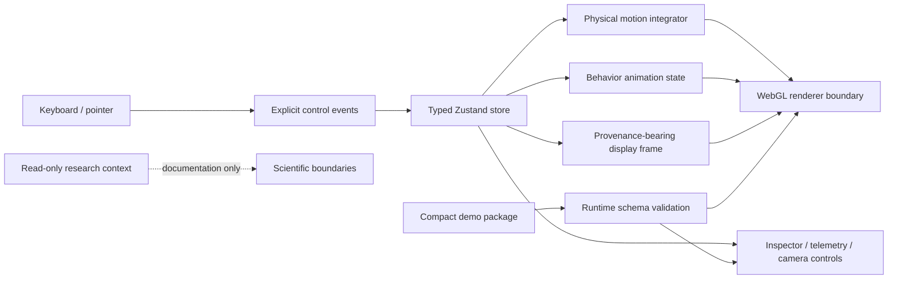
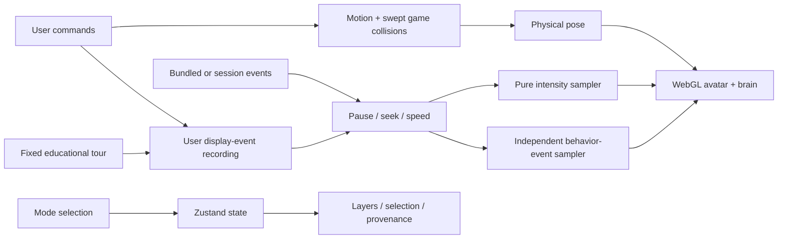

# Architecture

The React shell owns navigation, controls, scientific labels, dialogs, and the metadata inspector. The stable React Three Fiber WebGL canvas renders procedural geometry. Zustand coordinates typed control state and camera transitions. Zod guards external package and activity boundaries.



There is no path from activity overlays to physical motion. No simulator participates in this diagram.

## State and data flow

```mermaid
sequenceDiagram
  actor User
  participant Input as Input adapter
  participant Store as Zustand state
  participant Motion as Motion integrator
  participant Clock as Studio clock
  participant View as Renderer + inspector
  User->>Input: W pressed
  Input->>Store: FORWARD / PRESS / USER
  Store->>Store: Save control event + illustrative frame
  Clock->>Store: Frame tick (delta capped at 50 ms)
  Store->>Motion: Integrate held physical inputs
  Motion-->>Store: Updated pose
  Store-->>View: Pose + source-labeled overlay
  User->>Input: Click brain / Tab
  Input->>Store: BRAIN_INSPECTION; remember world mode
  Store->>Store: Clear motion; pause locomotion
  Store-->>View: Hide exterior; ease camera to head
  User->>Input: Escape / Back
  Input->>Store: Restore previous world mode
  Store-->>View: Restore exterior and camera; no held input
```

## Module responsibilities

| Module | Responsibility |
| --- | --- |
| `src/app` | Application shell, navigation, dialogs, composition |
| `src/world` | WebGL boundary, capability/error states, collision model, environment, camera rig, rendering metrics |
| `src/fly` | Pure physical integrator and procedural animated avatar |
| `src/brain` | Clickable placeholder display volumes; scalar-to-emissive rendering |
| `src/circuits` | Validated small demo and universal geometry warning |
| `src/activity` | Source labels, event construction, intensity/behavior sampling, replay and timeline UI |
| `src/controls` | Studio clock, keyboard event adapter and pointer/keyboard movement pad |
| `src/inspector` | Geometry/evidence metadata and source mode display |
| `src/experiments` | Explicit unavailable capability boundary; no model execution |
| `src/data` | Types, Zod schemas, size limits, user-selected package validation |
| `src/state` | Pose, control events, behavior lifecycle, camera modes, display clock |
| `src/ui` | Shared CSS, native dialog, code-native icons |
| `src/utils` | Reserved utility directory; avoid unnecessary abstractions |
| `scripts/preprocess` | Reserved offline package-preparation boundary |
| `public/assets` | Reserved asset namespaces; currently no anatomical meshes |

## Renderer and performance

`WorldCanvas.tsx` is the renderer boundary. Its descriptor declares WebGL and non-anatomical coordinates. A future WebGPU evaluation can replace that boundary while retaining contracts and state; no WebGPU adapter is implemented or required. The stable v9 renderer was chosen with the [documented React 19 pairing](https://r3f.docs.pmnd.rs/getting-started/installation).

The frame clock updates pose and display time. React selectors avoid subscribing all panels to pose changes; textual telemetry samples at 10 Hz. Time deltas are capped to avoid background-tab teleports. Device pixel ratio is capped at 1.75; shadows use one 1024px map. Geometry is small and generated locally. Orbit controls and fly refs are mutated on animation frames rather than reconstructing the geometry.

Control history is capped at 40 entries and completed behavior history at 30. Nothing is persisted between reloads. The demo is bundled and runtime-validated, avoiding a startup fetch dependency. The browser never reads the MaleCNS research directory.

Biological package validation caps text at 2 MiB and counts at 500 neurons, 5,000 directed edges, and 100 regions. The separate educational schema caps packages at 64 generic nodes, 128 illustrative relations, and 10 regions. These are engineering safeguards, not biological inclusion thresholds. Future larger compact packages need an explicit performance review, versioned limits, and offline preprocessing.

## Prompt 02 changes (current)

The single clock now lives in `controls/useStudioClock.ts` and advances the typed store even if WebGL is unavailable. Physical time and display transport remain separate. The scene samples state on render frames; text telemetry remains at 10 Hz. `world/PerformanceMonitor.tsx` samples actual rendering statistics once per second.



There is still no edge from intensity to physical motion. In rule/replay mode the physical pose is held and the event's gesture is demonstrated in place. System/neuronal targets and their generic relations are held in a separately validated educational package.

`world/collision.ts` defines both obstacle placement data and the conservative cylindrical collision model. Rendering reuses those definitions. `fly/animation.ts` is a pure pose sampler supporting explicit gesture states and reduced motion. Camera focus can target a generic region or node; no anatomical transform is claimed.

All 13 demo neurons share one instanced mesh. Regions use memoized components; limb transforms and scratch colors/matrices are reused. There are no particles or growing animation buffers. Display history is capped at 120 events, control history at 40, behavior history at 30. Hidden layers remove geometry/hit targets and incident demo relations. Package/help/science/experiment dialog content is lazy-loaded. The stable WebGL backend, 1.75 DPR cap, and 1024px shadow map are retained.

## Prompt 03 real-data boundary

The standard-library offline adapter in scripts/preprocess reads pinned source CSVs/manifests and emits versioned JSON, a small catalog and checksums. It never modifies or serves the research directory. Source lock and browser budgets live in config.

The lazy RealDataWorkspace fetches one package, checks streamed size/SHA256/catalog identity, then applies the strict schema-3 guard. Custom-file loads get explicit lower assurance for supplied scientific provenance. Package records stay separate from the avatar/transport store.

Pure graph adapters filter existing records and isolate only package partners or saved paths. SVG uses a disclosed 300-arrow display cap and paginated full raw tables. Raw counts affect edge width only, not display intensity or motion. Real highlights sample an explicit user FEED event through a separate educational mapping.

Morphology is lazy and fetched for one selected body. Exact native SWC rows are verified and batched into a line geometry; centering changes a display buffer only. Source files, native coordinates and scientific records stay unchanged.

See DATA_INTEGRATION.md and CIRCUIT_PACKAGE_FORMAT.md for guards, limits, scope and provenance.

## Checkpoint 03A control boundary

The store retains a Set of physical key codes, separate movement-pad inputs, viewport focus and measured forward/turn speed. The keyboard adapter converts eligible keydown/up events into Set changes; it never advances position. Aliases combine at the motion-action boundary, with existing user-provenance event recording. Focus, blur, visibility and explicit transitions clear input. Listener cleanup is tested independently of React rendering.

The single existing studio clock drives delta-time integration. The motion integrator proposes an exact constant-speed arc; the collision resolver alone owns obstacle and world-bound corrections. Speeds derive from the resolved displacement. No collision mutates the held command or speed constants. Locomotion diagnostics derive from measured motion and inspection/playback state; authored gesture and replay contracts remain separate. No scientific package or activity schema changed.

The viewport uses a capture-phase focus handler so scene picking cannot bypass activation. Document focus changes deactivate keyboard controls. Movement-pad presses focus before setting their own input to avoid a focus-loss release erasing a fresh pointer press. MaleCNS navigation explicitly deactivates world input. Browser hit testing and actual focus behavior still require the pending Playwright/manual acceptance.
